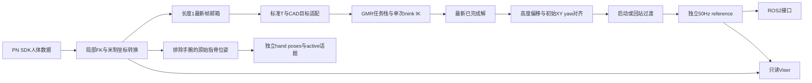

# 数据流与运行边界

离线回放从用户提供的NPZ直接进入世界位姿路径，不导入SDK、不连接PN。`--dry-run` 同时关闭ROS发布。RP1.3.2 模型与固定 GMR 核心源码已随仓库提供；Python/ROS 运行依赖按安装说明配置。

## 输入与几何适配

PN原生平移是厘米、X左/Y上/Z前。桥接转换为米、X前/Y左/Z上，位置为原生`zxy/100`，四元数采用wxyz并相应换轴。SDK局部平移已经是完整父坐标系偏移，FK不重复叠加BVH OFFSET。

PN标准T-pose是解析定义，默认人体标量骨长沿用当前工作区中获用户授权的录制派生尺寸，不采用录制帧中的姿态。默认人体标准根高度为1.0095348389594085 m；旧中性标定（根高度0.91 m、左右大腿/小腿各0.43 m）保留为独立可选文件。发布时保留当前数值，只移除来源录制路径、哈希和帧数并改相对模型路径。目标位置通过人体骨段方向、RP1 CAD段长与静态关节偏移重建；根位移单独使用0.78。目标姿态用固定标准bind偏置转换。可选pitch和支撑预处理在IK前执行，其启用状态取决于显式配置。

GMR负责装载模型与建立任务栈，本集成每次仅调用一次mink QP并积分当前结果。`third_party/GMR` 保留固定版本的 `motion_retarget.py`；最小包入口只导入此核心，空注册表由 PN 适配器临时填入当前模型和标定，不包含其它机器人资产、上游查看器或人体数据工具。它不是逐关节欧拉角复制，也没有多未来帧优化。核心包含关节角度、速度、可选关节加速度/制动、根部限制及地板接近约束；没有动力学平衡或接触力求解。

## 接收、求解与发布

SDK事件轮询目标100 Hz；实际新PN帧率由设备与SDK决定。长度1邮箱会覆盖尚未求解的旧输入，worker最多每20 ms取一次最新帧，且只有一个请求在途。没有积压队列或未来帧预取。

reference发布循环独立按20 ms调度，读取最新完成解；计算尚未完成时可以重复上一解。迟到时跳过过期节拍，不集中补发历史帧。因此50 Hz发布并不保证每秒有50个不同PN解。软件调度属于软实时。

## 独立手指发布

GMR和旧欧拉角实时入口沿用 `/mocap/hand/{left,right}/poses`（`geometry_msgs/PoseArray`）与 `/mocap/hand/{left,right}/active`（`std_msgs/Bool`），默认50 Hz、QoS `best_effort` / depth 1；没有增加新的手指话题。这一分支使用PN经坐标轴、厘米到米和父子FK转换后的原始指骨世界位姿：`frame_id=world`，位置为米、消息四元数为xyzw。不经过身体 scale、IK、根高度偏移、初始对齐或启动过渡，不产生机器人手指电机角，也不采用Pico的26点布局。身体reference不含手指。

每侧最多19点：先为 `HandThumb1/2/3`，再按 Index、Middle、Ring、Pinky，各自依次为 `InHand{Finger}`、`Hand{Finger}1/2/3`，所有骨名带左右前缀。手腕仍参与输入FK和身体IK，但不进入手指数组。缺失点省略、不填零；`active` 仅表示存在至少一个手指位姿，只有手腕时数组为空且为false。不完整消息的索引会随缺失点变化；原20点订阅端须更新索引，重启发布程序生效。配置与订阅命令见 [手指话题说明](CONFIGURATION.md#独立手指话题)。

## reference后处理

进入跟随时记录一次最新IK与当前reference的XY/yaw，之后保留相对运动。Z加配置的固定偏移，根roll/pitch和关节沿用IK。默认两秒过渡对位置/关节线性混合、四元数做SLERP；回站保持当前XY/yaw并过渡到待机姿态。

没有最终QP、第二次限速、再次锁脚或自动落地步骤。固定高度偏移与过渡可能使最终reference不再满足核心IK的脚高或运动限制。日志中的 `solver_qpos` 是原始IK，`desired_qpos` 与实际输出 `qpos` 相同。

## Viser的显示变换

机器人使用MuJoCo FK和附带RP1模型的网格；这里不执行动力学仿真。

- 蓝色是原始21点PN世界骨架的显示副本。
- 紫色是全部21点统一缩放的显示比较层，不等于CAD适配后的IK目标。
- 橙色是保存的14个实际IK任务点。
- XY居中给显示stage施加同一平移，骨盆对齐只额外平移PN显示副本；这些操作不进入求解或发布。

最终reference的高度偏移不施加到蓝/紫/橙层。实时集成Viser收到与ROS相同的reference向量，以及另一个最新原始PN样本；两者可能不是同一源帧。离线配对文件则保留源采样索引供对照。

SDK、ROS与查看器是分开的边界。SDK库只在live时通过loader加载，优先使用仓库附带的Python接口及对应架构Linux库；ROS运行在ABI匹配的系统环境；IK/Viser运行在显式Python子进程。正常退出会关闭桥接启动的子进程。
